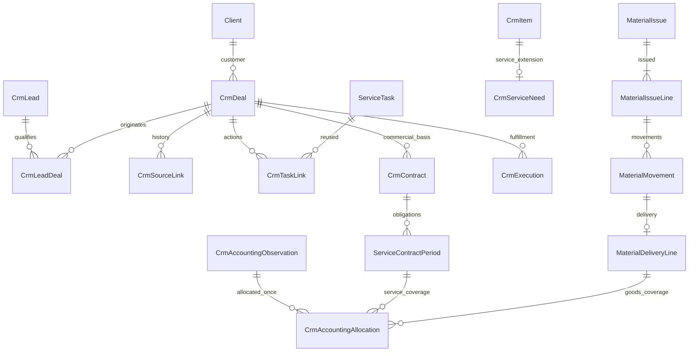

# CRM Аквалайн: этап 0 — архитектура

Дата: 25 октября 2026 года. Репозиторий: `borovikov88/service2`.
Статус: проектное решение для следующей задачи реализации. Этот пакет не меняет
код, схему БД, права, интеграции или production и не подтверждает их готовность.

Пакет состоит из [исходного ТЗ 0.4](crm-spec-v0.4.md), этой архитектуры,
[плана переноса и матрицы прав](crm-migration-access-plan.md) и
[последовательности PR с приёмкой](crm-pr-plan.md).

## 1. Основания, результат сверки и границы доказательств

- Аудит ТЗ: `7cbcc6cb1c13ddd362b3420913b32a365109e261`.
- Проверенный актуальный `main`: [`3416f0038556c2b6f0bf58c93eadb77541bde350`](https://github.com/borovikov88/service2/commit/3416f0038556c2b6f0bf58c93eadb77541bde350).
  Получен через GitHub и повторно проверен перед записью. Локальный HEAD совпадал;
  исходное рабочее дерево чистое. Документация подготовлена в `docs/crm-stage-0`.
- Прочитаны [AGENTS.md](../../AGENTS.md), применимые части
  [рабочего цикла](codex-direct-flow.md), [deployment](deployment.md) и
  [финансового контракта](management-finance-contract.md). Названия capability,
  моделей и ограничений ниже проверены в коде этого HEAD.
- Между снимками изменились 35 файлов: 3045 добавленных и 157 удалённых строк.
  Из 21 файла репозитория, на которые ссылается ТЗ, 20 имеют тот же Git blob.
  Исключение — `estimate_views.py`: добавлена инициализация гравийной подложки.
  Также изменены калькулятор, его тесты/документация и публикация/медиа Авито с
  соответствующими workflow. Схемы CRM/коммуникаций/КП, финансовые источники,
  `AGENTS.md` и обработчики из аудита не менялись. Публикация объявлений Авито
  не является исправлением приёма сообщений Авито.
- Сохранённая копия ТЗ должна побайтно совпадать с приложением:
  SHA-256 `7d62928e59f4b006e7588b20ec28f140f670729364a0a3914d3aef3fca80f526`.
- Production HEAD, количество рабочих записей, корректность сопоставлений
  сотрудников, фактические договоры, формат писем и полнота источников 1С здесь
  не проверялись. Рабочая БД, live 1С и UI не открывались; тесты не запускались.
  Наблюдения production из ТЗ не объявляются повторно подтверждёнными.

Критерии готовности этапа 0: воспроизводимая сверка; одна модель владения данными;
карта повторяемого переноса и прав; последовательность обозримых PR с приёмкой и
отдельными проверками миграций, доступа и финансов. Блокирующих этап 0 вопросов нет.

### Актуальность замечаний A01–A18

| Замечания | Свидетельство в текущем коде | Вывод для плана |
| --- | --- | --- |
| A01 | `services/task_generation.py:144`, `services/task_archive.py:6` | Задача меняет поля `CrmItem`, завершение архивирует service. Новая коммерческая связь не участвует в этой синхронизации |
| A02 | `views.py:572–618`, `services/permissions.py:84` | Роли CRM собраны по всем организациям, организация выбирается отдельно. Риск остаётся, нужен первый защитный PR |
| A03 | `views.py:4763`, особенно выборка `related_tasks` | Карточка берёт связанные задачи без фильтра приватности. Нужен общий серверный фильтр до расширения CRM |
| A04–A05 | `models.py:569`, `forms.py:1031` | `CrmItem` остаётся общей моделью четырёх направлений; лидов, сделки и коммерческого результата отдельно нет |
| A06, A09–A10 | `views.py:4307–4748`, `forms.py:1140`, `communication_views.py:138` | Код списков, счётчиков и назначения из аудита не менялся; исправления остаются в плане |
| A07 | `communication_clients.py:18` | Контакты из текста участвуют в capture; при неоднозначности возможна новая карточка. Нужны происхождение и разбор |
| A08 | `estimate_models.py:9` | КП имеет организацию и версии, но не прямую CRM-связь/принятый вариант |
| A11–A14 | `communication_avito.py`, `communication_models.py:300`, `communication_services.py:73` | Ограничения истории/медиа/времени из аудита сохраняются; исправлять адаптер, сохраняя outbox |
| A15–A16 | `services/task_generation.py:198`, `models.py:806` | Поиск только активной supply-задачи, свободный текст материалов; структуры выдачи/доставки нет |
| A17 | `finance_imports/odata_profit_drafts.py:1085` | `period_month` вычисляется из `source_date`, не является месяцем оказанной услуги |
| A18 | `finance_imports/money_forecast.py:205` | Отсутствие дебиторки в более свежем снимке даёт `no_current_receivable`; для закрытия CRM этого недостаточно |

A02/A03 — статически подтверждённые риски, а не доказательство утечки рабочих
данных. Для A06/A09–A14 подтверждено отсутствие изменения кода аудита; поведение
провайдера и воспроизведение под ролями требуют будущих целевых тестов.
Все пути таблицы относятся к `pool_service/` и указанному SHA.

## 2. Зафиксированные бизнес-решения и выбранный подход

| Решение владельца | Как отражается в архитектуре |
| --- | --- |
| D01 | Однократное назначение принявшему новый отвеченный звонок; атомарное явное взятие свободного обращения; чтение не назначает |
| D02, D08 | Открытая строительная сделка передаётся Александром одним действием; успех отдельно требует завершения и полной оплаты |
| D03–D04 | Существующая сервисная потребность; режим по позиции: включено, обычная химия, согласуемое оборудование/работа |
| D05 | Самостоятельный товарный интерес проходит розничный лид; полная воронка каждого чека не вводится |
| D06 | Менеджер видит командные сделки своей организации, без наследования доступа к приватным источникам/финансам |
| D07 | Ручные торги и место для почтового адаптера; автоматический отбор выключен до Q13 |
| D09, D12 | Быстрая запись выдачи без визита/лида; доставка и возврат — отдельные предлагаемые контрольные действия; месячная сводка |
| D10 | Конкретные договорные периоды, покрытие строками реализаций и подтверждённый расчёт по договору |
| D11 | Основной сервисный и разовые договоры имеют самостоятельные обязательства, документы и расчёты |

Выбран **отдельный коммерческий слой внутри существующего Django-приложения
`pool_service`**. `CrmItem(service)` остаётся операционной заявкой; коммерческие
`project/sales/tender` переносятся в `CrmDeal`. После переключения старые
коммерческие записи доступны только как история/переадресация. Расширение одного
`CrmItem` оставило бы опасную общую синхронизацию с задачами и смешение архива,
выполнения и продажи; поэтому здесь оно не выбрано.

Новые имена таблиц и сервисов — техническое предложение этого этапа, а не
утверждение об их существовании. Четыре стартовые воронки и их этапы берутся из
§7 ТЗ как предлагаемые настройки. Это не дополнительные подтверждённые ответы
владельца. Воронка, организация доступа и юридическое лицо продавца независимы.

## 3. Модель данных и владельцы фактов

На схеме показаны основные отношения. У финансового распределения ровно один
тип целевого основания; линии услуг и товаров не считаются одновременно двумя
полными распределениями. Не все таблицы и поля показаны на диаграмме.

### 3.1. Коммерческое ядро

| Сущность | Основные поля и связи | Ограничения |
| --- | --- | --- |
| `CrmPipeline`, `CrmStage` | Organization; стабильный code; название, порядок, active; у этапа pipeline и набор кодов правил перехода | Уникальны `(organization, code)` и `(pipeline, code)`. Использованный этап отключается, не удаляется; правила — разрешённые валидаторы, не исполняемый пользовательский код |
| `CrmLead` | Organization, тип client/tender, клиент nullable, потребность, источник привлечения, канал первого контакта, first_occurred_at/received_at, assignee, status/result/reason, follow_up_at, revision, archive | Нет обязательного телефона/бюджета/Client для тендера. Бюджет: unknown/exact/range с валютой; отложенное/ожидание требуют причины и даты |
| `CrmDeal` | Organization, pipeline/stage, specialization, fulfillment_kind, client, manager, сумма/валюта/основание, outcome, закрытие/архив, revision; отдельно даты заказа, передачи, завершения, расчёта | Результат open/won/lost/cancelled отделён от этапа и архива. Для legacy допускается unknown с признаком качества; неизвестная сумма — NULL |
| `CrmLeadDeal` | Lead, Deal, qualification_operation, purpose_key | Один лид → несколько самостоятельных сделок; `(lead, purpose_key)` уникален в операции. Сделка может иметь несколько подтверждённых источников, суммы считаются по deal ID |
| `CrmParticipant` | Deal, существующие Client/ClientContact/ClientCompanyLink, роль, источник подтверждения | Несколько ролей у одного человека допустимы. Все ссылки проверяются по организации; контакт прораба не становится заказчиком |
| `CrmDealObject` | Deal, либо Pool, либо ClientOwnedObject, роль/основной объект | Ровно одна ссылка на объект; несколько объектов поддерживаются структурой. Объект без организации проверяется через Client; неподтверждённый scope не допускается |
| `CrmCommand` | Organization, operation_key, command_type, payload_hash, actor, результат | Уникальный ключ операции; повтор с тем же содержимым возвращает результат, с другим — конфликт. Проверка прав выполняется и при повторе |
| `CrmEvent` | Lead или Deal, тип, actor, occurred_at/recorded_at, безопасный diff, command, типизированная ссылка на источник | Неизменяемая история; один субъект события, несколько ссылок через отношения. Полные сообщения/расшифровки в журнал не копируются |

Разделение/объединение лидов хранит отдельные связи происхождения и событие
решения. Оно не переносит автоматически уже созданные сделки, КП, договоры или
финансовые распределения. Дополнительная сделка после квалификации — новая
явная команда. Принятый вариант КП — одно коммерческое решение, а не три сделки.

### 3.2. Повторное использование существующей базы

| Существующее | Новая связь / расширение | Единственный источник истины |
| --- | --- | --- |
| Client, ClientCRMProfile, ClientContact, ClientCompanyLink | Статус предварительной идентификации в профиле, предложения контактов с источником и решением; участники сделки | Клиентская база остаётся общей. `onec_ref` не пересоздаётся. Для новых нескольких баз 1С нужен namespace-aware реестр внешних идентификаторов, без удаления старого поля |
| ClientOwnedObject, Pool | Явное `ClientObjectServiceLink(owned_object, pool, accepted_by, accepted_at)` при принятии на обслуживание | Будущий хамам/полив не создаёт активный Pool. У одного owned_object одна подтверждённая связь с соответствующим Pool; неоднозначности разбираются |
| ServiceTask, ServiceTaskChange | `CrmTaskLink`: задача → lead/deal/execution, назначение связи; основной следующий шаг выбирается среди связанных задач | Срок/ответственный/статус действия хранятся в ServiceTask. Один primary next step на субъект через отдельную уникальную запись; никакой второй системы задач |
| Conversation, ConversationMessage, PhoneCall, MessageAttachment | `CrmSourceLink` → lead/deal: весь диалог, явные сообщения, подтверждённый интервал либо звонок | Оригинал, запись, вложение, assignee диалога остаются в коммуникациях; менеджер сделки не подменяет их владельцев |
| PoolEstimate, PoolEstimateVersion | `CrmEstimateLink` связывает расчёт с одной сделкой; `CrmProposal` фиксирует конкретную версию и variant либо внешний файл | Калькулятор, версии и его текущая логика песка/гравия сохраняются. Принятие не ссылается на изменяемый draft |
| CrmItem(service), WaterReading | `CrmServiceNeed` как OneToOne-расширение существующей заявки + структурированные строки и ревизии потребности | Это коммерческие атрибуты той же заявки, не вторая заявка и не обязательный лид |
| ServiceVisitPlan, WaterReading | Планирование/факт визита связываются с исполнением и договором | Существующие календарь и журнал; факт визита не доказывает реализацию или оплату |
| Финансовые модели и сервисы | Типизированные внешние ссылки, наблюдения версий и распределения (§5) | Учётные суммы/состояния только из подтверждённого финансового контура; CRM не становится второй 1С |

Для потребности вводится уникальное происхождение
`(organization, source_kind, source_id, need_sequence)`: у исходной записи журнала
первоначально одна последовательность. Обычное повторное сохранение или изменение
текста меняет ревизию той же потребности, а не её ключ. Новая самостоятельная
потребность после исполнения создаётся явной командой с новой последовательностью.
Этот ключ сохраняется после завершения/архивирования задачи; существующие дубли
разбираются перед включением ограничения.

В `CrmSourceLink` — явные FK и проверки допустимых сочетаний, без произвольного
GenericForeignKey для денежных или организационных связей. Выбранные сообщения
хранятся в дочерних связях. Ссылка на весь диалог требует явного решения: один
диалог может содержать разные потребности. Timeline, поиск, выгрузка и уведомления
всегда пересекают доступ к сделке с актуальным доступом к источнику.

`CrmProposalDispatch` хранит адресата, канал, версию/вариант, автора, provider ID,
статусы planned/accepted_by_provider/delivered/read/failed/unknown по возможностям
канала. Печать не равна отправке. Используется существующий Avito outbox; неизвестный
результат POST не повторяется вслепую. Внешняя отправка — отдельная отметка с
источником. Принятие, отклонение и замена предложения имеют собственные события.

### 3.3. Договоры, исполнение, обслуживание

| Сущность | Содержание и кратность |
| --- | --- |
| `CrmContract` | Organization, ответственный, заказчик/плательщик, продавец и внешний agreement reference, kind=construction/regular_service/one_off. Один основной коммерческий процесс на реальный договор; у сделки допускаются несколько учётных заказов. Связь с основным сервисным договором у разового — контекст, не объединение долга |
| `CrmContractRevision` | Неизменяемые согласованные условия: период действия, валюта, состав/стоимость, включения/исключения, график, основание, автор и дата. Поправка создаёт редакцию; прежний договорный объём не стирается |
| `CrmContractObject` | Договор → набор существующих объектов; состав и параметры обслуживания по редакции. Структура допускает много объектов; включение такого сценария зависит от Q09 |
| `CrmContractObligation` | Строка согласованного обязательства: вид, состав, объект, количество/единица, стоимость и основание. Оборудование/ремонт — отдельный разовый договор по D11; изменение объёма того же договора требует подтверждённого изменения основания |
| `ServiceContractPeriod` | Договор + стабильный ключ периода YYYY-MM; дочерние обязательства по объектам/услугам. N берётся из условий, не константа 12; редакции меняют состав с историей, не размножают месяцы |
| `CrmExecution` | Deal, Contract, kind, согласованная редакция объёма, исполнитель, плановые даты, состояние, приёмка; unique `(deal, fulfillment_key)` |
| `CrmClosureEvidence` | Deal, версия обязательств, акт/подтверждение работ, проверка расчётов и покрытия, набор активных источников, actor/time, версия правил; неизменяемое основание состоявшегося закрытия |

Для разовой сервисной работы `CrmExecution` связывает имеющуюся заявку, не создаёт
повторную. У стройки это минимальный контейнер проекта. У торгов тот же Deal и
тот же сервис передачи создают исполнение по предмету закупки; автоматической
второй продажи в предметной воронке нет.

Действующие условия договора после явного переключения становятся источником
`Pool.service_frequency/service_monthly_price/...`: поля Pool — совместимая
проекция для текущего календаря, с версией происхождения и контролируемым
обновлением. Прямое независимое редактирование проекции для связанного договора
закрывается. Для объектов без перенесённого договора сохраняется текущая логика.
Если одновременно действуют разные условия на одном Pool, нельзя выбрать
«последние»: нужен разбор/расширение планировщика. Текущая уникальность
`ServiceVisitPlan(pool, week_start)` не поддерживает несколько независимых
плановых выездов в неделю; такой запуск выделен в условный PR по Q09.

### 3.4. Материалы и месячная сводка

`MaterialIssue` содержит организацию, сотрудника, объект/клиента, даты выдачи и
ввода, источник (включая бумажный журнал), автора и статус проверки. Ни визит,
ни потребность, ни договор не обязательны. `MaterialIssueLine` содержит
номенклатурный идентификатор либо проверяемое исходное название, упаковку,
единицу, положительное Decimal-количество и назначение.

`MaterialMovement` — неизменяемые движения строки: доставка, возврат в офис,
изменение назначения и корректировка со ссылкой на исходное движение. Доставка
создаёт одну `MaterialDeliveryLine` как подтверждённый факт на фактическом объекте.
Все команды имеют ключ повторяемости и автора; исправление не переписывает
оформленные количества. На заблокированной строке проверяется баланс выдачи:
выдано + подтверждённые корректировки = доставлено + возвращено + у сотрудника.
Переназначение меняет получателя количества, а не увеличивает общий объём.
Возврат после доставки имеет обратную связь и требование сверки документа.

`MonthlySettlement` — запрос/представление, не таблица второго заказа и не
автоматический договор. Группировка: организация, клиент, объект, фактический
месяц доставки, затем продавец, плательщик, договор, валюта, номенклатура и
совместимая единица. Разные упаковки/цены сохраняют раскрываемые исходные строки.
Выдачи без результата видны независимо от смены месяца. Неизвестная цена — NULL;
при подготовке оформления фиксируются цена, её источник и дата.

Менеджер связывает выбранные подтверждённые строки с фактическим разовым
договором. `CrmDeal` с `origin=existing_object_supply` создаётся один раз на
самостоятельный заказ коротким путём, без фиктивного лида/КП на каждую выдачу.
Обеспечивается уникальность подтверждённого коммерческого основания; повторный
месячный запрос ничего не создаёт. Распределения в документы учитывают только
остаток поставки. Режим по позиции потребности позволяет везти обычную химию,
пока насос согласуется. Учёт складских остатков и запись документов в 1С не входят.

### 3.5. Торги

`TenderOpportunity` — организация, реестр/номер/лот или проверенная каноническая
ссылка с provisional identity, предмет, заказчик как исходные сведения, место
исполнения, дедлайн с исходным timezone, цены отдельно (начальная/предложенная/
контрактная), процедура и решение менеджера. `TenderRevision` сохраняет версии.
Одна возможность связана с предварительным лидом и затем одной сделкой; письмо
рассылки не создаёт Client отправителя. Повтор размещения с новым номером —
отдельная возможность с возможной связью происхождения.

Отложенный адаптер: `TenderMailReceipt` с уникальным ID письма в mailbox/connection,
ссылкой на защищённый оригинал и состоянием разбора; несколько извлечённых лотов;
`TenderSelectionDecision` с версией правил, основаниями и unknown/review.
Дедупликация письма и лота независимы. Старое письмо не отменяет новый дедлайн
или ручное решение. До Q13 `selection_mode=unconfigured`, автоматическое
одобрение/исключение и создание «подходящих» лидов выключены. Ручная воронка
работает. Почтовое подключение, фильтры и API не объявляются существующими.

## 4. Команды, приём событий и транзакционные гарантии

Модули: `crm_models.py`, `crm_permissions.py`, `crm_queries.py`,
`services/crm_intake.py`, `crm_commands.py`, `crm_contracts.py`,
`crm_materials.py`, `crm_accounting.py`; маршруты/формы используют эти сервисы.
Модели подключаются к существующему app/migration graph по принятому в проекте
паттерну. Отдельный backend, брокер и новая платная AI-интеграция не требуются.

1. В транзакции приёма существующего сообщения/звонка сохраняется
   `CrmInboundEvent` с ключом `(organization, source_namespace, source_kind,
   external_id)`, ссылкой на оригинал, occurred_at/received_at и historical.
   Один звонок — одно событие с несколькими ревизиями результата. Каждая ревизия
   создаёт запись обработки с уникальной версией/отпечатком нормализованного
   изменения; повтор webhook не блокирует последующее событие ответа на звонок.
2. Фоновая management command забирает сохранённые задания с lease, попытками,
   next_attempt и состояниями pending/processing/done/review/error. Перезапуск
   не теряет очередь; bounded reconciliation по курсору обнаруживает пропуски
   между сохранением источника и постановкой задания. AI не нужен для приёма.
   Неизвестный внешний ID отправляется на разбор идентичности, а не получает
   выдуманный глобальный ключ. Диагностика без тела сообщений/секретов.
3. Связывание: подтверждённая связь источника → подтверждённый контекст потребности
   → предварительный лид/уточнение. Один номер и самая свежая сделка недостаточны.
   Исторический импорт не создаёт текущие лиды/уведомления без отдельного правила.
   Внутренние/личные звонки исключаются до формирования коммерческих превью.
4. D01: подтверждённое соответствие TelephonyEmployeeIdentity/PhoneCall активному
   пользователю назначает только новый свободный лид. Неоднозначный перевод —
   общая очередь с причиной. Поздний ответ не затирает ручное взятие/назначение;
   повторный звонок другого сотрудника не меняет менеджера существующей сделки.
5. Взятие — условный update свободной строки с проверкой revision/прав внутри
   транзакции; второй менеджер получает конфликт и актуального владельца.
   Квалификация, передача, смена этапа, распределения и закрытие используют
   `CrmCommand`, блокировку субъекта, проверку версии, единую валидацию и событие.
   Уведомления создаются с уникальным ключом в той же транзакции и доставляются
   после commit через существующий механизм. Нет рассылок клиентам по умолчанию.
6. Все FK валидируются в заданной организации, включая lookup/bulk/admin. DB
   constraints защищают уникальность и локальные количества; межтабличные scope
   и суммы распределений проверяются сервисом под блокировками. Нельзя рассчитывать
   только на `Model.clean()`, который не вызывается каждым ORM save/bulk.

База по умолчанию MySQL, локальные test settings — SQLite. Уникальные активные
ссылки моделировать явными pointer/OneToOne-таблицами, не опираться на partial
unique indexes/deferrable constraints PostgreSQL. Дедупликационные ключи имеют
канонизацию и проверенную чувствительность collation. Конкурентные сценарии
проверяются на MySQL, SQLite не доказывает корректность блокировок.

Индексы: организация+статус/архив+updated_at+id, организация+manager+stage,
организация+due_at, источник+external_id, contract+period, issue_line+movement,
документ+line identity, batch+status. Timeline грузится порциями. Общий QuerySet
фильтров используется таблицей, канбаном и счётчиками; сортировка стабильна по id.
Живой поиск 250–350 мс, отмена старого запроса и URL-state по AGENTS.md.

## 5. Финансовые связи и доказательство закрытия

### 5.1. Что есть и чего недостаточно

| Источник текущего кода | Можно использовать | Нельзя утверждать по одному этому источнику |
| --- | --- | --- |
| `OneCMonthlyProfit`, `OneCReportPeriodState`, подтверждённый batch | Выручка/стоимость/ВП активной версии; recorder, тип, GUID документа, строка и номенклатура в `source_data` | PK строки и `source_identity` не являются вечным ID строки реализации; финансовый месяц не задаёт месяц услуги |
| `OneCMoneyForecastRow/Snapshot` | Ссылки на order/document/agreement, ожидания и графики с полнотой | `matched_paid_amount`/`no_current_receivable` не универсальный платёжный реестр |
| `SettlementPositionRow`, `OneCFinancePositionSnapshot` | Остаток на дату по organization/counterparty/agreement/document/order и классификация | Отсутствие строки не доказывает оплату; сводное сальдо клиента не оплачивает каждый договор |
| `ManagementMoneyPlan` | Подтверждённое ожидание и календарь `service_active_months` | Фактическое оказание, реализация, платёж и договорный перечень месяцев |
| ДДС и read-only `management_finance` | Подтверждённые денежные факты/агрегаты с областью и полнотой | Произвольное распределение банковской суммы по заказам; второй расход себестоимости |

Текущий код не доказывает достаточность документного платёжного источника для
всех D02/D10. Поэтому PR-25 предусматривает проверку реального контракта чтения
и при необходимости расширение сохранённого импорта, с отдельным финансовым
ревью. До этого неизвестная оплата блокирует только успешное закрытие, а не CRM,
выдачи, работу или действие Александра. Открытие карточки не вызывает live 1С.

### 5.2. Реестр ссылок и распределений

- `CrmAccountingDocument`: уникально `(organization, source_namespace,
  document_type, document_guid)`; namespace обозначает базу источника, а не URL
  временного подключения. Seller/source organization GUID сохраняется отдельно
  и проверяется по разрешённому набору текущего финансового контура. Разрешённая
  межюридическая связь 1С не запрещается искусственным требованием равенства GUID.
- `CrmAccountingObservation`: документ, активный batch/snapshot, исходная дата,
  состояние проведения/отмены, currency и основание полноты. Для строк — тип,
  номенклатура, количества, суммы, договорная принадлежность и revision fingerprint.
  Это техническое наблюдение сохранённого источника, не новая учётная проводка.
- Постоянная идентичность строки устанавливается только по подтверждённому
  контракту источника. Если доступен лишь номер строки/изменяемый fingerprint,
  ссылка привязана к версии. При перестановке/удалении строк требуется повторная
  проверка, а не совпадение по названию. JSON `source_data` не выгружается в CRM целиком.
- `CrmAccountingAllocation`: строка наблюдения → ровно одно обязательство,
  период услуги либо доставка; тип распределения, Decimal quantity/amount,
  единица, валюта, база НДС, автор/основание/статус проверки. Сумма и количество
  всех распределений строки не превышают доступные значения; остаток явный.
  Один документ может покрыть несколько месяцев/заказов, но не полной суммой каждый.
- `CrmSettlementEvidence` и распределения: подтверждённый расчёт по конкретному
  договору/документу, источник, дата, валюта, назначение, возвраты/зачёты,
  полнота набора обязательств, статус verified/unknown/review/contradicted.
  Не приравнивать зачёт/корректировку к банковскому платежу. Общая оплата
  распределяется один раз; неизвестная принадлежность остаётся нераспределённой.

Финансовые наблюдения связываются с версиями, а суммы для карточки читаются из
канонических сервисов. Активация/отмена batch помечает зависимые проверки
неактуальными. Закрытие повторно проверяет токен активных источников и редакцию
договора под согласованными блокировками; устаревший расчёт не проходит.
Cost-only строки прямых затрат не покрывают услуги/поставки. Банковский платёж
не создаёт второе событие себестоимости. Приоритет плана 1С перед связанным
ручным ожиданием Service2 сохраняется.

### 5.3. Условия закрытия

**Стройка/монтаж (D02):** подтверждён актуальный согласованный объём → есть
допустимое доказательство завершения этого объёма → доказан полный расчёт именно
по этому основанию, с учётом подтверждённых изменений. Только затем явная команда
закрытия сохраняет `CrmClosureEvidence`. Полномочие подтверждать окончание работ
и ручной документный fallback оплаты остаются открытой частью Q03/Q11; fallback
пока выключен. Аванс не является условием передачи D08 или финальным успехом.

**Регулярное обслуживание (D10):** для каждого предусмотренного периода и
обязательства по объекту/услуге есть полное подтверждённое покрытие действующими
строками реализаций; расчёт по основному договору полон и проверен. Пустой или
неизвестный набор месяцев не даёт логического «все покрыты». Четыре документа
по три месяца допустимы, двенадцать с пропуском месяца — нет. Частичное покрытие
остаётся частичным. Счёт/план/визит/выдача не покрывают период. Дата документа
не определяет период услуги; нет дополнительного ожидания конца года/срока.

Химия/ремонт по отдельному договору не закрывают месяцы и своим долгом не
блокируют D10. Общий нераспределённый платёж не доказывает оплату основного
договора. Смешанный документ распределяется только согласно его фактической
договорной принадлежности; обнаруженное противоречие требует сверки в учёте.
Нельзя переименовать принадлежность строки ради желаемого закрытия.

При корректировке после закрытия сохраняются дата/основание прошлой команды и
новое видимое расхождение. Повторное исполнение и молчаливое переписывание итога
не запускаются. Для розницы/разовых работ финальный предикат остаётся не настроен
до оставшейся части Q03; «товар передан и оплачен» — предложение, не решение.

## 6. Что решить перед соответствующими PR, не сейчас

| Вопрос ТЗ | Статус и безопасная граница до решения | Момент |
| --- | --- | --- |
| Q01 | Обычное распределение решено D01; переводы проверяются технически, замещение настраивается явно | PR-07/09, перед автоматическим назначением/эскалацией |
| Q02 | Общие воронки и специализации — проектное предложение; особые обязательные анкеты не придумываются | PR-12, при настройке специализаций |
| Q03, Q11 | D02/D08/D10 не пересматриваются; не назначены подтверждающий завершение, замещение, ручной fallback оплаты и финальное правило розницы/разовой работы | PR-18 и PR-26/27; до этого соответствующее действие закрытия недоступно |
| Q04 | Решён: D11/D12. Электронные контрольные действия описаны как доработка, не как существующая практика | Реализация PR-20/21 по отдельной задаче |
| Q05 | Самостоятельная розница определена; обычные чеки не получают обязательную полную воронку | Перед адаптером чеков/коротким POS-путём, отдельный условный PR |
| Q06 | Командный просмотр решён; чужая запись, переназначение, финансовые поля и публикация рабочих полей private-потребности — отдельные разрешения | До выдачи capabilities PR-03, публикации PR-15 и финансовых экранов |
| Q07, Q08 | Действующие подключения переиспользуются; ручные торги включены. Допканалы и почтовое подключение требуют описания источника | Отложенный PR-T1 / отдельные адаптеры |
| Q09 | Структура допускает N месяцев и набор объектов; несколько выездов за неделю не обещаны текущим календарём | Перед включением multi-object/нового календарного сценария PR-19 |
| Q10 | Asia/Barnaul; явный срок следующего действия. Нет выдуманных SLA, числа попыток и расписания эскалаций | Перед автоматическими сроками PR-09/11 |
| Q12 | Показатели заданы в ТЗ; объём стенда, приоритеты и p95 ≤2 с пока предлагаемые | Инвентаризация PR-13, performance/приёмка PR-30 |
| Q13 | Явно отложен. Автоматический отбор не настроен; ручные торги и основная CRM независимы | Только отложенный PR-T2 |

Это реестр границ дальнейшего внедрения, а не новый опрос владельца. Технические
ключи, транзакции, FK, индексы и разбиение моделей решены здесь и проверяются
разработчиком и ревьюером. Перед реализацией актуальный main сверяется заново.
